# Sakshar · साक्षर · ਸਾਖਰ

Sakshar is an OCR and voice assistant for Indian government paperwork. Upload a photo, scan or PDF of a land record (UP Khatauni, Maharashtra 7/12 Satbara, Punjab Jamabandi), an application form or a certificate. Sakshar then:

1. **Reads it.** OpenCV preprocessing, then PaddleOCR with a Tesseract fallback, with script and language detected automatically.
2. **Extracts key details.** Layout analysis with XY-cut finds names, dates, amounts and application, khasra or survey numbers, then checks each value against a schema for that document type.
3. **Flags uncertain values.** Low OCR confidence, a failed validator (including the Aadhaar Verhoeff checksum), a value missing from its source text, or two extractors disagreeing all send a value to amber review. Review shows a crop of the source region.
4. **Explains it in plain language,** in **Hindi, Marathi, Punjabi or English**. Every point cites the text it came from (click a point to highlight it on the page). Claims that can't be grounded are marked as unverified.
5. **Answers follow-up questions by voice or text.** Speech goes through Whisper large-v3-turbo, IndicTrans2, grounded Q&A over hybrid BM25 and fuzzy retrieval, then Indic Parler-TTS for the spoken answer.

```
upload ─► preprocess ─► script detect ─► OCR ─► layout ─► classify ─► extract ─► verify ─► explain
          (deskew RGB,   (OSD + Unicode  (Paddle  (XY-cut   (keyword   (regex +   (gates,   (OpenAI, cited
           CLAHE fork,    blocks, hi/mr)  / Tess)  + lines)  + LLM)     LLM)       masking)  + grounded)
           binary fork)
                                              voice:  webm ─► faster-whisper ─► IndicTrans2 ─► Q&A ─► Parler-TTS
```

## Setup (Windows, conda)

> Install conda to a path **without spaces** (e.g. `C:\miniconda3`). Conda's post-link scripts break under `C:\Users\FIRST LAST\...`.

```powershell
# 1. environment (Python 3.11, Tesseract from conda-forge, CUDA 12.4 torch)
conda env create -f environment.yml
conda activate sakshar

# 2. Tesseract language data: conda-forge's tesseract already ships hin/mar/pan/eng/osd.
#    Only needed for a non-conda Tesseract install:
python scripts/setup_tessdata.py

# 3. configuration
copy .env.example .env      # then set OPENAI_API_KEY (and HF_TOKEN for voice)
```

**Voice models.** Two of the models are gated on Hugging Face. Accept the terms for `ai4bharat/indictrans2-en-indic-dist-200M`, `ai4bharat/indictrans2-indic-en-dist-200M` and `ai4bharat/indic-parler-tts`, then put your token in `HF_TOKEN`. All voice models download on first use (about 3 GB). To run without them, set `ENABLE_VOICE=false`.

**Channels.** The env uses conda-forge only, so no Anaconda ToS acceptance is needed.

## Run

```powershell
conda activate sakshar
python scripts/make_samples.py          # sample hi / mr / pa / en documents -> samples/
uvicorn sakshar.main:app --reload       # http://localhost:8000
```

`GET /healthz` reports the Tesseract path, the installed language packs, whether the LLM is configured, and which voice models are loaded on which device.

## Example run (screenshots)

These screenshots come from one local run in Microsoft Edge, driven with Playwright, on the four bundled sample documents. All screenshots are in [`screenshots/`](screenshots/).

**1. Upload and live progress.** Drop a photo or PDF, then watch each pipeline stage complete. The first stage has already measured and corrected the photo's tilt (+3.5°).

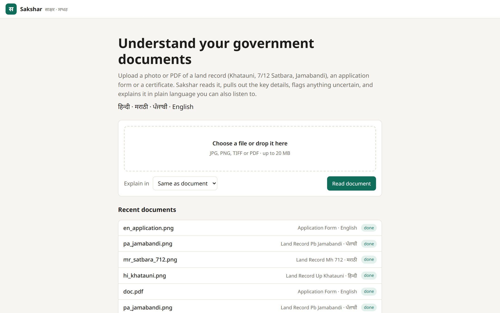
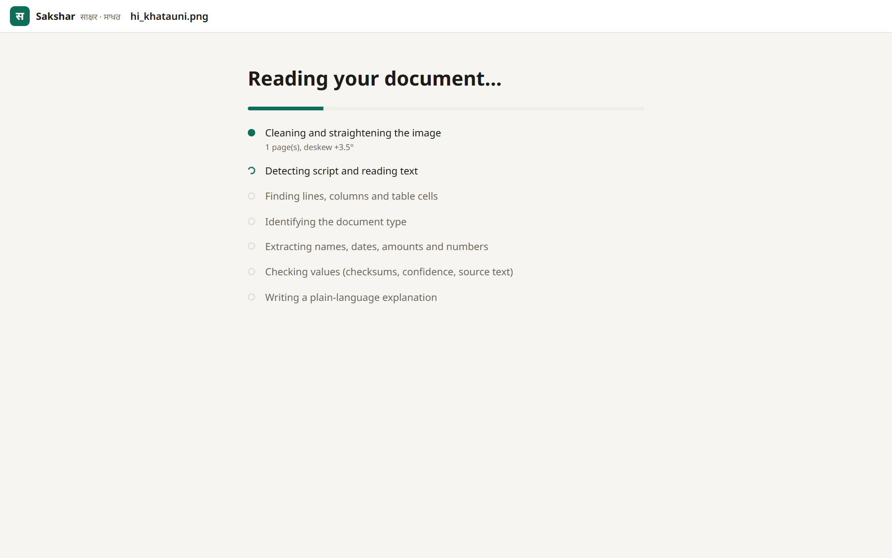

**2. Reading a Hindi Khatauni.** On the left, the straightened page with every recognised text block outlined; amber outlines mark low-confidence text. On the right, the extracted fields in the Hindi interface. Header chips show the detected document type, language and script, and the OCR route used.

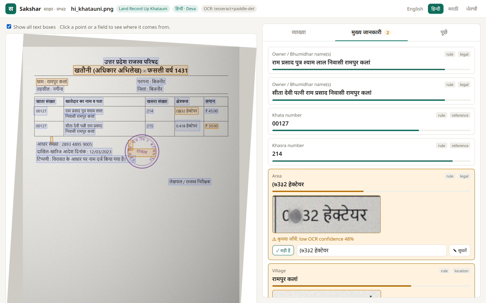

**3. Every value points to its source.** Clicking "Khasra number 214" highlights the exact cell on the page that the value was read from.

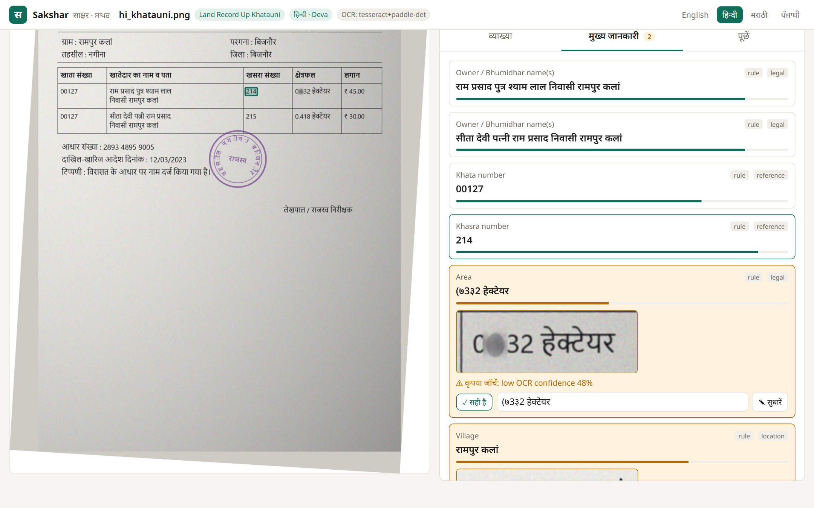

**4. Uncertain values are flagged, not guessed.** The area value has a smudged digit. Sakshar shows a crop of the original, the reason ("low OCR confidence 48%") and two buttons, *Looks right* and *Correct it*. Once corrected, the value is marked as entered by you and normalized (0.632 hectare).

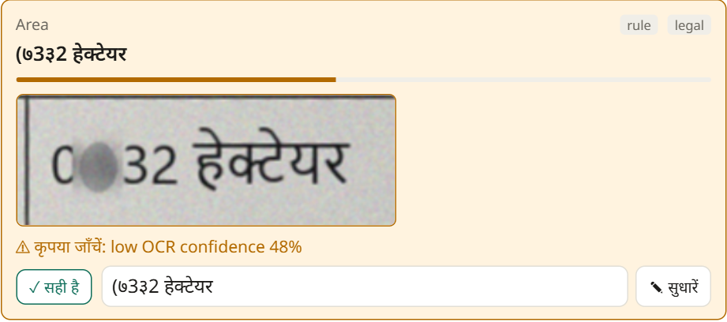
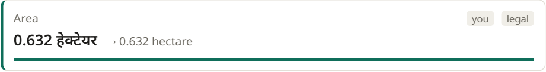

**5. Ask by voice.** Tap the mic and ask in Hindi, Marathi, Punjabi or English. This question was recorded through the browser's microphone. Whisper transcribed it correctly, including the plot number spoken digit by digit ("दो एक चार").

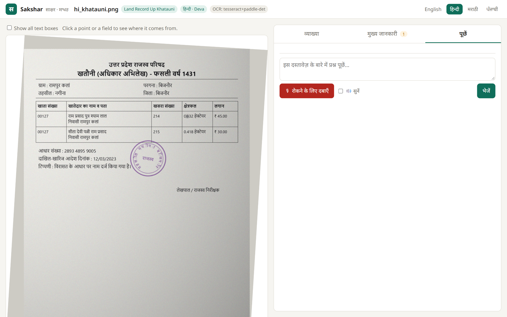
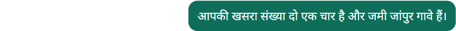

**6. Marathi, Punjabi and English documents.**

- Marathi 7/12 (Satbara): the area `1.20.00` is read as 1 ha 20 are (1.2 hectare).
- Punjabi Jamabandi: low-confidence owner and cultivator cells come with crops for review.
- English application: every field is read, and the Aadhaar number is masked.

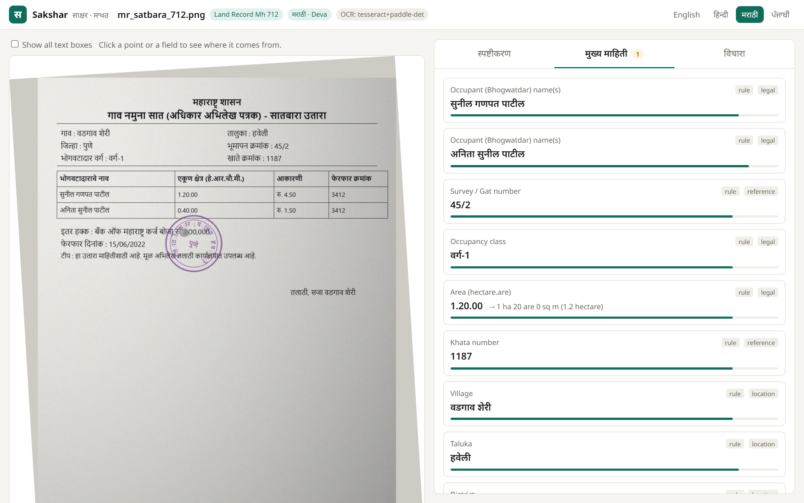
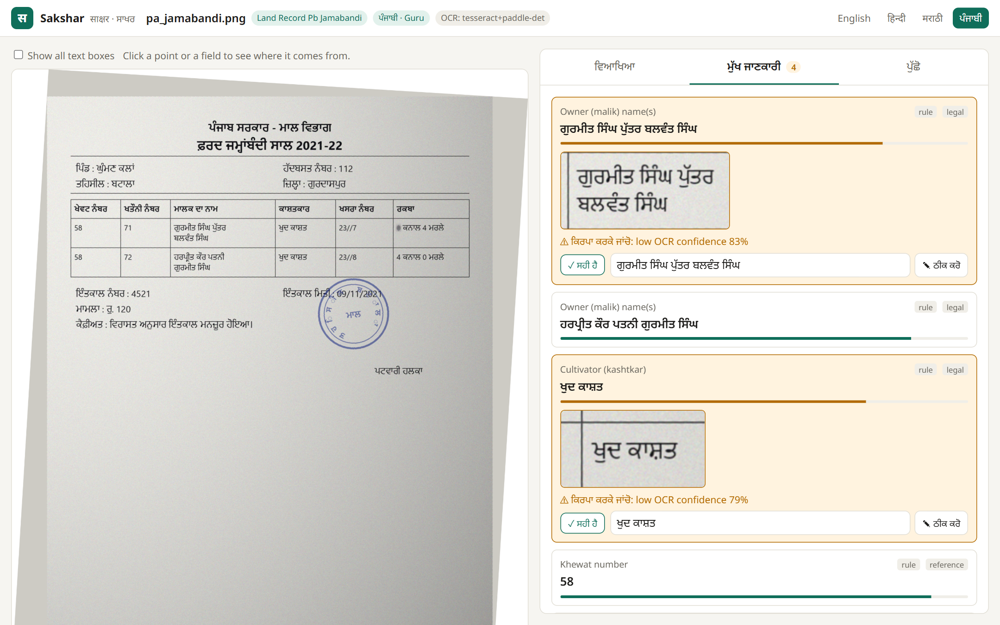
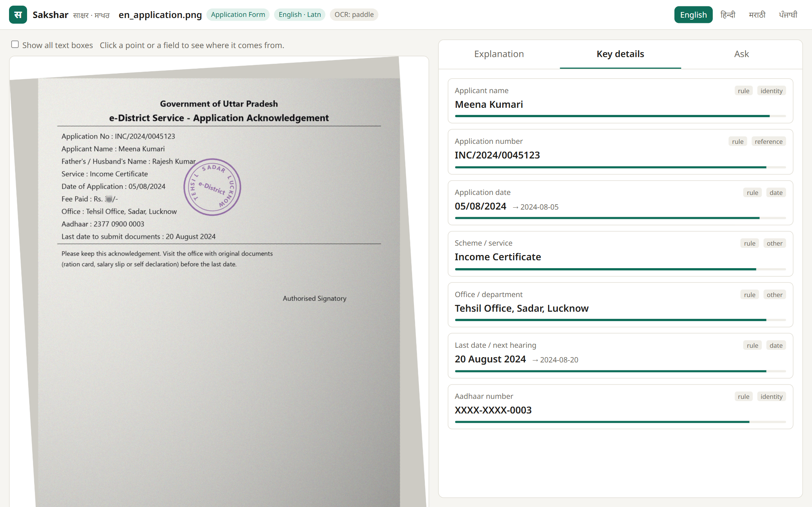

**7. Dark theme and phone layout.**

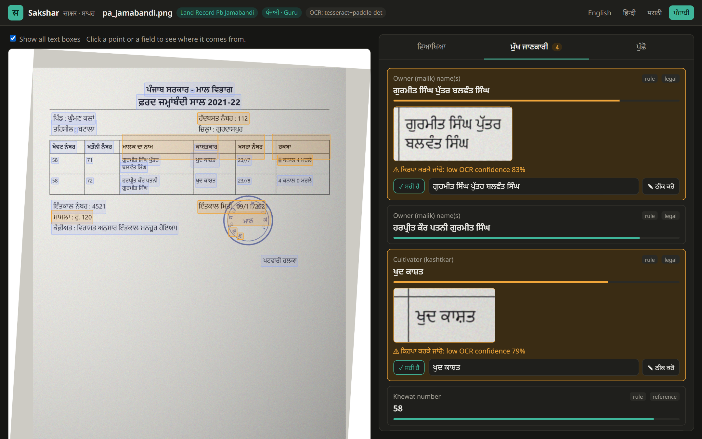
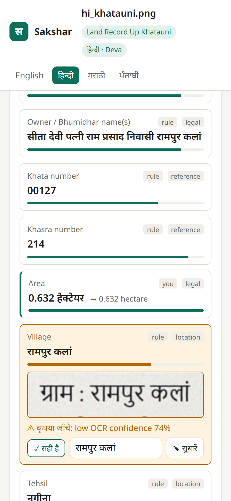

## Extraction accuracy

Accuracy is measured on a test set of four documents: a UP Khatauni, a Maharashtra 7/12 extract, a Punjab Jamabandi and an English application acknowledgement. Each one is built to mimic a messy real-world scan:

- a 3.5° tilt;
- an ink stamp over a date;
- uneven lighting and scanner noise;
- one deliberately smudged digit.

Every field on these documents has a known correct value, so each extracted field is checked against it.

| Measure | Result |
| --- | --- |
| Values extracted correctly | **41 of 44 (93% precision)** |
| Values on the page found | 41 of 49 (84% recall) |
| Wrong values flagged for review | **3 of 3 (100%)**: every error came from a smudged digit, and none was shown as certain |
| Language and document type detected | 4 of 4 |

**How it is measured:**

- **Field level.** Each extracted value is compared with the known correct value. Numbers must match exactly.
- **Error handling.** For every wrong value, the run checks whether it was flagged for review.
- **Engine choice by measurement.** OCR engines, image preprocessing and page-segmentation modes were compared head to head on the same documents; this decided which engine reads each script.
- **50 automated tests** cover every stage: orientation and deskew, script detection, parsing, checksums, layout, verification gates, grounding and end-to-end flows.

## Tests (50)

```powershell
pytest
```

The tests cover:

- deskew angle recovery, and stamp colour surviving the viewer image
- the preprocessing forks sharing the same dimensions
- script detection, including hi vs mr
- Devanagari and Gurmukhi digits, amounts and multilingual dates
- Verhoeff, PAN and masking
- the XY-cut column separation
- each verification gate
- grounding: drops a citation to a missing block, flags a wrong value, repairs a citation
- hybrid retrieval finding `खसरा` when the OCR read `खसस`
- a full API flow (upload → SSE → fields → review → explanation → Q&A) with mocked OCR and a mocked OpenAI client, which also asserts that no unmasked Aadhaar number ever reaches the LLM

## Configuration (`.env`)

| Variable | Default | Meaning |
|---|---|---|
| `OPENAI_API_KEY` | – | Enables classification fallback, LLM extraction, explanations and Q&A |
| `OPENAI_MODEL` | `gpt-4o-mini` | Any model that supports structured outputs |
| `OPENAI_BASE_URL` | – | Any OpenAI-compatible endpoint (vLLM, Azure, Groq, Ollama `/v1`) |
| `TRANSLATION_ENGINE` | `llm` | `llm`: the model writes the local-language text directly, keeping revenue terms. `indictrans2`: translate offline |
| `ENABLE_VOICE` | `true` | Whisper, IndicTrans2 and Parler-TTS |
| `ENABLE_PADDLE` | `true` | `false` forces Tesseract only |
| `DEVICE` | `cuda` | `cpu` to keep the GPU free |
| `REVIEW_THRESHOLD` / `REVIEW_THRESHOLD_STRICT` | 0.75 / 0.85 | Minimum OCR word confidence for ordinary fields / for legal, financial and identity fields |
| `MASK_PII` | `true` | Store Aadhaar numbers masked (`XXXX-XXXX-1234`) |

## Design notes

- **Sideways scans.** Scanned land-record printouts often arrive rotated 90°. The page orientation is decided in two steps. First, geometry: which smearing direction turns the text into lines. Then, only when that is unclear, OCR picks the 0°/90°/270° reading with the most normally shaped confident words. Tesseract's own orientation detector proved unreliable on Indic pages. This passed 64 of 66 orientation checks across test pages in three orientations.
- **Two preprocessing forks.** The original RGB is deskewed first and served to the viewer, so stamps keep their colour. Both OCR inputs come from that image and share its dimensions: CLAHE grey for PaddleOCR, and an adaptive-threshold binary for Tesseract only, since hard binarization damages Devanagari matras for neural OCR. Boxes therefore map 1:1 onto the displayed page.
- **Gurmukhi.** PaddleOCR has no Gurmukhi recognizer. Punjabi gets one full-page Tesseract pass, then PaddleOCR detects text boxes and any lines the page pass missed are re-read with `--psm 7`. Those re-reads run 8-wide in a thread pool, because Windows process start-up is slow.
- **Concurrency.** Pipeline stages run in `asyncio.to_thread`, so SSE progress keeps streaming. PaddleOCR calls are serialized with a lock. SQLite runs in WAL mode with `check_same_thread=False`.
- **GPU (6 GB).** Whisper large-v3-turbo in int8_float16, IndicTrans2 in fp16 for both directions, and Parler-TTS in fp16 stay resident together. In testing, three of these models used about 3.6 GB. Models are offloaded only on a CUDA out-of-memory error.
- **OCR engine per script, chosen by measurement.** PaddleOCR's Devanagari recognizer dropped spaces and conjuncts while still reporting ~0.95 confidence. Hindi, Marathi and Punjabi therefore use Tesseract for recognition and PaddleOCR only to detect text lines. The Hindi and Marathi Tesseract models also misread Latin digits, so an English-only pass repairs numbers. English uses PaddleOCR fully, with the mobile models (8 s per page instead of 50 s).
- **Paddle runs on a single dedicated thread.** Its CPU predictor fails ("Unknown exception") when used from a thread other than the one that created it. Torch is imported before Paddle because the reverse order breaks torch on Windows (WinError 127, `shm.dll`).
- **Voice details.**
  - Revenue terms such as खसरा (which is also Hindi for "measles"), खाता and ਖੇਵਟ are swapped for their romanised forms before IndicTrans2 sees them.
  - Numbers are spelled out digit by digit before TTS, because Parler mispronounces numerals.
  - Whisper "small" produced unusable Punjabi, so the default is `large-v3-turbo`.
  - The language selected in the UI is passed to Whisper, because auto-detection mislabels Marathi and Punjabi as Hindi.
- **Grounding.** Statements carry `text_en` and `text_local` plus the block ids they cite. Any hard value (a number with 3+ digits, a date or an amount) must appear in the cited text. If it appears elsewhere in the document, the citation is repaired; otherwise the statement is marked unverified.
- **Privacy.** Aadhaar numbers are validated locally with the Verhoeff checksum and masked before any text is sent to the LLM or stored.
